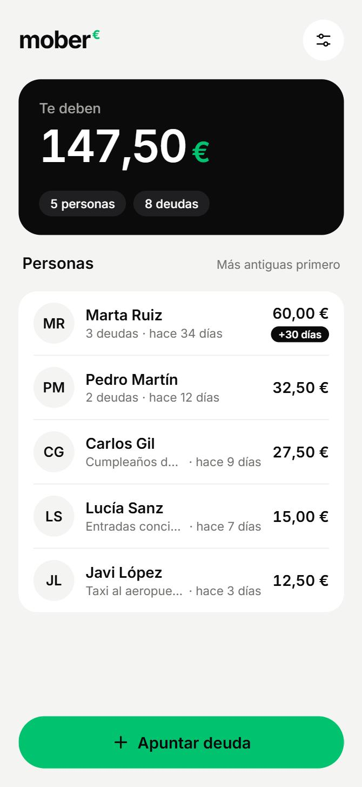
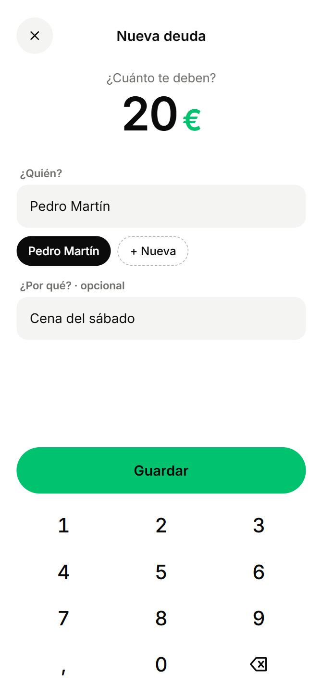
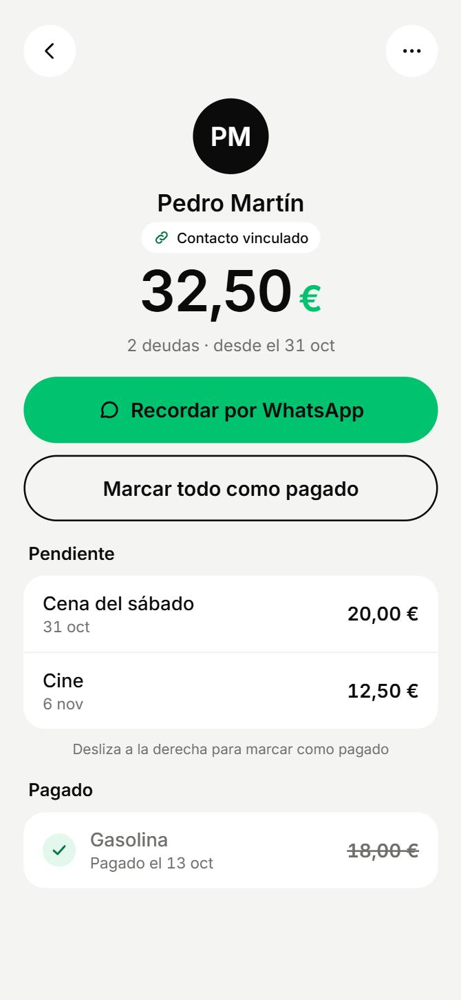
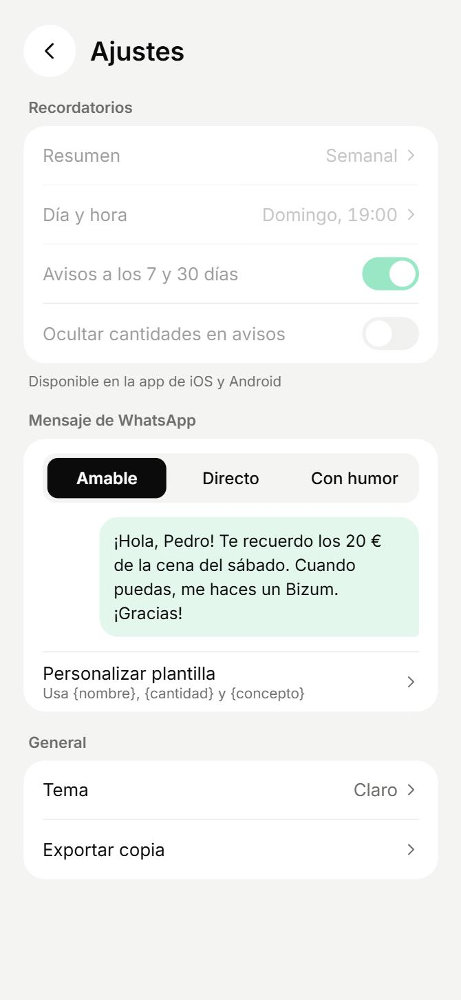
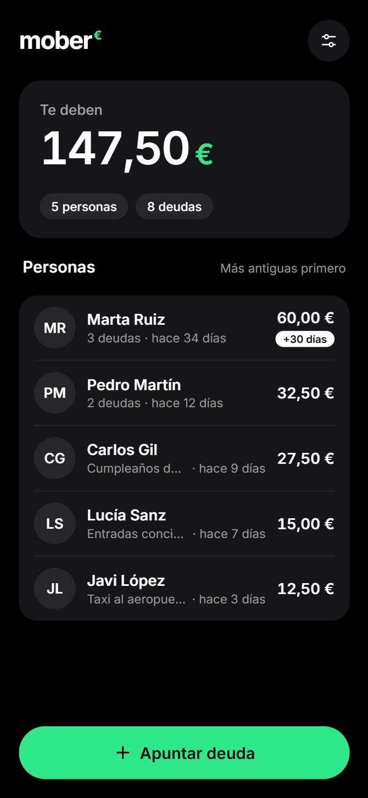

# Mober

**Lo que te deben, recordado.**

Mober es una app para iOS y Android que sirve para apuntar quién te debe dinero, cuánto y por
qué, y que te lo recuerda sola con notificaciones. Apuntar una deuda cuesta menos de cinco
segundos: cantidad, nombre y, si quieres, el concepto. A partir de ahí, Mober se acuerda por ti.

- Sin cuentas, sin registro y sin servidor: los datos se quedan en tu dispositivo.
- Una sola tarea: registrar lo que te deben y no olvidarlo.
- También funciona como web, para probarla desde el móvil con un enlace.

**Versión web:** https://mober-beta.vercel.app

## Capturas

|               Inicio                |                  Nueva deuda                  |              Detalle de persona               |
| :---------------------------------: | :-------------------------------------------: | :-------------------------------------------: |
|  |  |  |

|                Ajustes                |                   Modo oscuro                   |
| :-----------------------------------: | :---------------------------------------------: |
|  |  |

## Qué hace

- **Inicio · Me deben.** El total en grande y una fila por persona, las deudas más antiguas
  primero. Etiqueta "+30 días" para las que llevan más de un mes.
- **Nueva deuda.** Teclado numérico propio y autocompletado de nombres, sin distinguir mayúsculas
  ni acentos, para que "Pedro" y "pedro" no sean dos personas.
- **Detalle de persona.** Desliza una deuda a la derecha para marcarla como pagada, con
  "Deshacer" durante 5 segundos. Historial de lo ya cobrado.
- **Recordar por WhatsApp.** Abre el chat con el mensaje ya escrito en el tono que elijas
  (Amable, Directo, Con humor o tu propia plantilla). Nunca se envía solo: siempre lo revisas tú.
- **Notificaciones locales.** Resumen periódico y avisos a los 7 y 30 días, como máximo uno al
  día, con los botones "Pagado" y "Recordar a…". Se programan en el propio móvil.
- **Ajustes.** Frecuencia y hora de los avisos, ocultar cantidades, tema claro u oscuro y
  exportar una copia en JSON.

## Tecnología

| Capa           | Elección                                                    |
| -------------- | ----------------------------------------------------------- |
| Framework      | React Native + Expo SDK 58 + TypeScript estricto            |
| Navegación     | Expo Router                                                 |
| Datos          | expo-sqlite detrás de un repositorio con interfaz única     |
| Estado         | Zustand                                                     |
| Notificaciones | expo-notifications (locales, con botones de acción)         |
| Gestos         | react-native-gesture-handler + react-native-reanimated      |
| Web            | react-native-web, exportada como SPA y desplegada en Vercel |
| Calidad        | Jest, ESLint y Prettier                                     |

### Estructura

```
src/
  app/         Rutas (Expo Router): inicio, nueva-deuda, persona/[id], historial, ajustes…
  theme/       Tokens de diseño: colores (claro y oscuro), tipografía, radios
  db/          Repositorio: interfaz, SQLite, localStorage de reserva y migraciones
  store/       Stores de Zustand y selectores
  features/    Pantallas y lógica por función: home, debts, person, settings,
               notifications, whatsapp, contacts
  components/  Componentes reutilizables: botones, hojas, teclado, fila deslizable…
  lib/         Utilidades puras: dinero, fechas, texto, teléfono
```

Las cantidades se guardan siempre como **céntimos enteros** (`amount_cents INTEGER`) y solo se
convierten a texto al mostrarlas, con `Intl` en `es-ES`: `147,50 €`.

## Ejecutarla en local

Necesitas [Node.js](https://nodejs.org) 20 o superior.

```bash
npm install
```

```bash
npm run web
```

Se abre en `http://localhost:8081`. En modo de desarrollo la web guarda los datos en
`localStorage`; para probarla tal y como se despliega (con SQLite en el navegador):

```bash
npm run build:web
```

```bash
npm run serve:web
```

Otros comandos:

| Comando             | Qué hace                                     |
| ------------------- | -------------------------------------------- |
| `npm test`          | Tests con Jest                               |
| `npm run typecheck` | Comprobación de tipos                        |
| `npm run lint`      | ESLint                                       |
| `npm run format`    | Prettier                                     |
| `npm run check`     | Tipos + lint + tests                         |
| `npm run icons`     | Regenera los iconos a partir de la identidad |

## Probarla en el móvil

### Como web

Abre https://mober-beta.vercel.app en el navegador del móvil. Para tenerla como una app:

- **iPhone (Safari):** Compartir → _Añadir a pantalla de inicio_.
- **Android (Chrome):** menú ⋮ → _Añadir a pantalla de inicio_ o _Instalar app_.

En web no existen las notificaciones, vincular contactos ni la vibración: aparecen desactivados
con la nota "Disponible en la app de iOS y Android".

### Con Expo Go

Instala [Expo Go](https://expo.dev/go) en el móvil, con el móvil y el ordenador en la misma wifi:

```bash
npx expo start --go
```

Escanea el código QR con la cámara (iPhone) o desde Expo Go (Android). Expo Go sirve para ver
las pantallas y los gestos, pero **no** para probar las notificaciones con botones ni los
contactos: para eso hace falta un development build.

### Con un development build

El development build es tu propia app con las herramientas de desarrollo dentro. Necesitas una
cuenta gratuita de [Expo](https://expo.dev):

```bash
npx eas-cli@latest login
```

```bash
npx eas-cli@latest build --profile development --platform android
```

Al terminar, EAS te da un enlace para instalar el APK en el móvil. Después arranca el servidor y
abre la app instalada:

```bash
npx expo start --dev-client
```

Para iPhone necesitas una cuenta de Apple Developer:

```bash
npx eas-cli@latest build --profile development --platform ios
```

## Publicar en las tiendas

```bash
npx eas-cli@latest build --profile production --platform all
```

```bash
npx eas-cli@latest submit --profile production --platform all
```

El identificador de la app es `com.mober.app` en las dos plataformas. El perfil `preview` genera
un APK instalable para repartir entre amigos antes de publicar:

```bash
npx eas-cli@latest build --profile preview --platform android
```

## Desplegar la web

La web se despliega en [Vercel](https://vercel.com) y cada push a `main` publica una versión
nueva. La configuración está en [`vercel.json`](vercel.json):

- Compilación: `npx expo export -p web`, que genera la carpeta `dist`.
- Todas las rutas se reescriben a `/index.html` (es una SPA).
- Cabeceras `Cross-Origin-Embedder-Policy` y `Cross-Origin-Opener-Policy`, necesarias para que
  expo-sqlite funcione en el navegador.

Para desplegar a mano:

```bash
npx vercel --prod
```

### Persistencia en web

Mober usa expo-sqlite también en el navegador cuando este lo permite. Si el navegador no lo
soporta, usa `localStorage` detrás de la misma interfaz del repositorio, sin que la app note la
diferencia. La elección se recuerda para que los datos no cambien de sitio entre visitas.

## Documentación del proyecto

- [Documento de proyecto](docs/Mober-documento.md): funciones, notificaciones, identidad y hoja
  de ruta.
- [Pantallas de diseño](docs/diseno/): las ocho pantallas de referencia.

Fuera de alcance por ahora: widget, pagos parciales, dividir gastos, fecha prometida, Face ID,
cuentas o nube y la pestaña "Yo debo".
